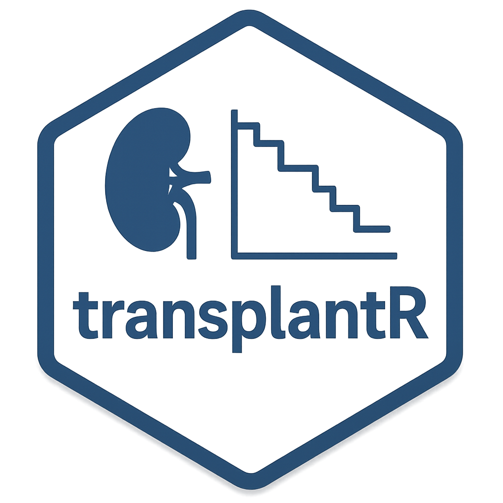

# transplantR 

Functions for transplant medicine and nephrology, including clinical risk indices, kidney function calculations, data extraction, and visualization tools.

## Features

### Clinical Risk Assessment
- **KDRI 2012** - Kidney Donor Risk Index (2012 version)
- **KDRI 2019** - Updated Kidney Donor Risk Index with risk categorization
- **GFR Calculation** - CKD-EPI 2021 equation for estimated glomerular filtration rate

### Data Processing
- **PDF Extraction** - Extract donor data from TransplantPath PDF reports with regex parsing
- **Cumulative Analysis** - Create time-series datasets for transplant activity tracking

### Visualization
- **Cumulative Plots** - Year-over-year comparison charts with automatic labeling

## Installation

```r
# Install from source
devtools::install_github("your-username/transplantR")

# Or install locally
devtools::install()
```

## Usage

### Calculate KDRI scores

```r
library(transplantR)

# KDRI 2012
kdri_2012 <- calc_kdri2012(
  donor_age_year = 45,
  donor_hypertension = "NO",
  donor_weight = 75,
  donor_days_in_hospital = 2,
  donor_adrenaline = "NO"
)

# KDRI 2019
kdri_2019 <- calc_kdri2019(
  donor_age_year = 55,
  donor_height = 175,
  donor_hypertension = "NO",
  donor_sex = "MALE",
  donor_cmv = "Negative",
  donor_egfr = 85,
  donor_days_in_hospital = 3
)

# Get risk category
calc_kdri2019_category(kdri_2019)
```

### Calculate GFR

```r
# CKD-EPI 2021 equation
gfr <- calculate_gfr(
  creatinine = 85,  # μmol/L
  age = 50,
  sex = "MALE"
)
```

### Extract donor data from PDFs

```r
# Extract from folder of TransplantPath reports
donor_data <- extract_donor_data_from_pdfs("path/to/pdf/folder")
```

### Create cumulative visualization

```r
# Prepare data
cum_df <- create_cumulative_df(
  transplants_df,
  report_year = 2025,
  report_month = 4
)

# Generate plot
plot_cumulative(
  cum_df,
  report_year = 2025,
  report_month = 4
)
```

## License

MIT License

## Author

Laszlo Szabo (laszlo.szabo@wales.nhs.uk)
ORCID: 0000-0002-6881-1542
